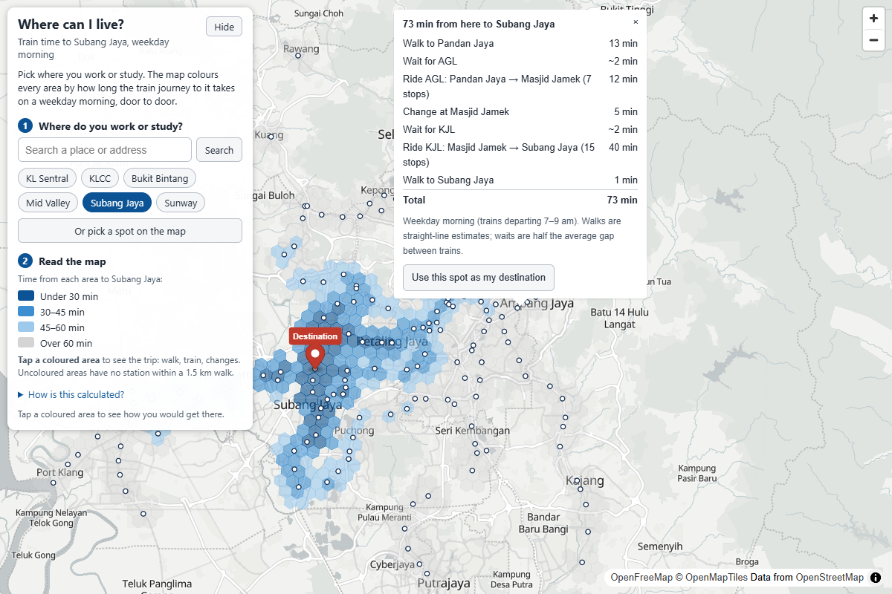
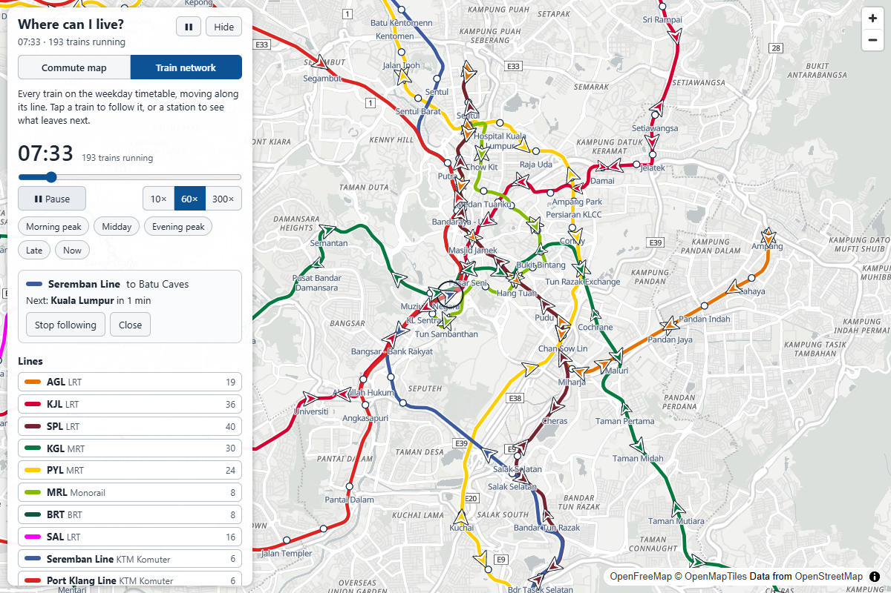

# Klang Valley commute map

Pick where you work or study, and see every part of the Klang Valley you could live in and get there by train within 30, 45 or 60 minutes.



Live site: https://anselloo.github.io/klang-valley-commute-map/

## What it does

The site opens on a worked example (KL Sentral) so you can see what it shows straight away. Then:

1. **Choose where you work or study**: search a place, tap a quick pick (KL Sentral, KLCC, Bukit Bintang, Mid Valley, Subang Jaya, Sunway), or choose "pick a spot on the map". You can also drag the pin.
2. **Read the map**: an H3 hex grid is shaded by total door-to-door travel time to your destination, for a weekday morning commute (under 30 min, 30–45, 45–60, over 60). Uncoloured areas have no station within a 1.5 km walk. Tap any coloured area for the trip: walk, wait, each ride with its line and stops, changes, and the final walk.

Shading updates in a few milliseconds. On a phone the controls sit in a bottom sheet that collapses to a short strip, so the map stays in view.

### Train network view

The **Train network** tab shows every train on the weekday timetable moving along its line.



- A clock runs the day from 05:00, with play/pause, 10×, 60× and 300× speed, a slider, and jumps to the morning peak, midday, evening peak, late night, or the current time of day.
- Trains are arrows in their line's colour, pointing the way they travel. They dwell at stations and ease between them.
- **Tap a train** to see its line, destination and next stop, and follow it with the camera.
- **Tap a station** for its next departures by line and direction, or use it as your destination in the commute view.
- **Tap a line** (on the map or in the list) to focus on it; the list also shows how many trains each line has running.

Rail only for v1: LRT, MRT, Monorail, BRT Sunway and KTM Komuter. No buses, no real-time data, no backend. See [SPEC.md](SPEC.md).

## How it works

A Python build step turns the official static GTFS feeds into small JSON files. The browser does the rest, with no server.

1. **Build** (`scripts/build_matrix.py`): downloads the feeds, keeps weekday Klang Valley rail, merges stops within 150 m into one station, and runs a shortest-path search from every station. Cost per trip is in-vehicle time, plus half the line's average headway as the first wait, plus half the next line's headway and 5 minutes for each change. A hand-maintained list of out-of-system walking links (`data/transfers.json`) joins stations that are close but not connected in the feeds.
2. **Browser** (`web/`, commute view): for a destination D, a station's time is the best of `matrix(S, T) + walk(T, D)` over stations T within 1.5 km of D. A hex's time is the best of `walk(H, S) + time(S)` over stations S within 1.5 km. Walking is straight-line distance × 1.3 ÷ 4.5 km/h.

3. **Train network** (`scripts/build_network.py`, `web/src/network.ts`): the build step writes the track geometry and the timetable to `data/network.json`. Prasarana publishes the track shapes and the headway for each part of the day, so its trains are generated from those headways and follow the real track. The KTMB feed has no track shapes, so the Komuter track comes from OpenStreetMap (`scripts/fetch_ktm_geometry.py` saves it to `data/ktm_shapes.json`, which the build reads offline); KTM trains use the feed's real trip times. The browser works out where every train is at the simulated time.

Times are for weekday mornings, using trains that depart 7–9 am. There is no separate 8:00 / 9:00 option: building one for each showed the two differ by about a minute for a typical trip, which is not worth asking a first-time visitor to choose.

## Run it locally

Needs Python 3.9+ (standard library only) and Node 20+.

```bash
# 1. Check the raw feeds (downloads to data/raw/, which is git-ignored)
python scripts/gtfs_check.py

# 2. Rebuild the data in /data (committed, so this is optional)
python scripts/build_matrix.py          # stations.json, matrix.json, graph.json (add --refresh to re-download the feeds)
python scripts/build_network.py         # network.json, for the train network view
python scripts/fetch_ktm_geometry.py    # only if the KTM track changes: refreshes data/ktm_shapes.json from OpenStreetMap

# 3. Run the site
cd web
npm install
npm run dev                             # development server
npm test                                # unit tests
npm run build && npm run preview        # production build
```

## Layout

```
scripts/     Python build step (gtfs_check.py, build_matrix.py)
data/        generated stations.json, matrix.json, graph.json, network.json, ktm_shapes.json (KTM track from OpenStreetMap), and hand-made transfers.json
web/         Vite + TypeScript frontend (MapLibre GL JS, h3-js)
docs/        README screenshot
.github/     workflows: deploy to Pages, monthly data refresh
SPEC.md      the v1 spec
```

## Deploying

`.github/workflows/deploy.yml` builds and publishes `web/` to GitHub Pages on every push to `main` that touches the site or the data. The repository's **Settings → Pages → Source** must be set to **GitHub Actions** (already done).

`.github/workflows/refresh-data.yml` runs on the 1st of each month, re-downloads the feeds, rebuilds the data, and commits it if anything changed.

## Caveats

- **Estimates, not a journey planner.** Waits are half the average headway, not a real timetable lookup, and walking ignores roads and rivers.
- **Feed gaps show up.** The KTM feed has long gaps on some lines in the morning peak (for example the Port Klang line), so some KTM stations look slow. The Kelana Jaya line takes about 98 minutes end to end in the Prasarana feed.
- **Transfer walk times are guesses.** The walks in `data/transfers.json` are estimates and are worth checking on the ground.
- **The train network is a simulation.** Prasarana trains are generated from published headways, not an exact timetable, so an individual train will not match a real one. KTM trips that start or end outside the Klang Valley are cut at its edge.
- **KTM schedule expiry.** The KTM calendar in the feed has an end date; the monthly refresh picks up new schedules.

## Data and credits

- GTFS static feeds from Malaysia's open data portal, [developer.data.gov.my](https://developer.data.gov.my/): Prasarana (`rapid-rail-kl`) and KTMB.
- Base map: [OpenFreeMap](https://openfreemap.org/) with [OpenStreetMap](https://www.openstreetmap.org/copyright) data, rendered with [MapLibre GL JS](https://maplibre.org/). KTM Komuter track geometry is also © OpenStreetMap contributors (ODbL).
- Search: [Nominatim](https://nominatim.org/), one request per search.
- Hex grid: [H3](https://h3geo.org/) via h3-js.
